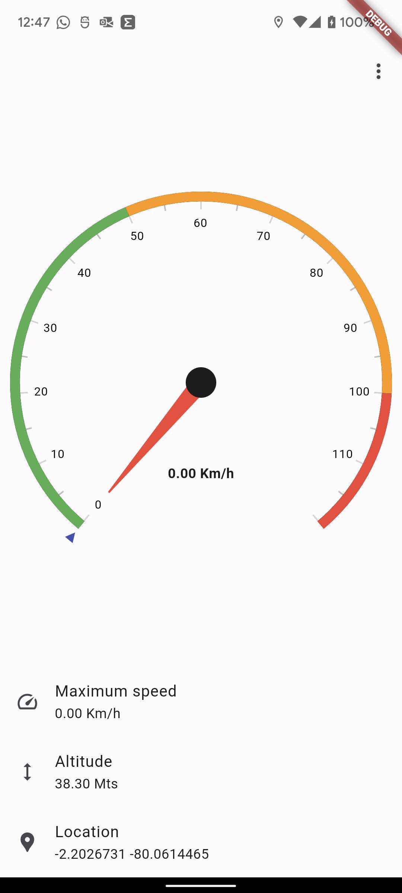
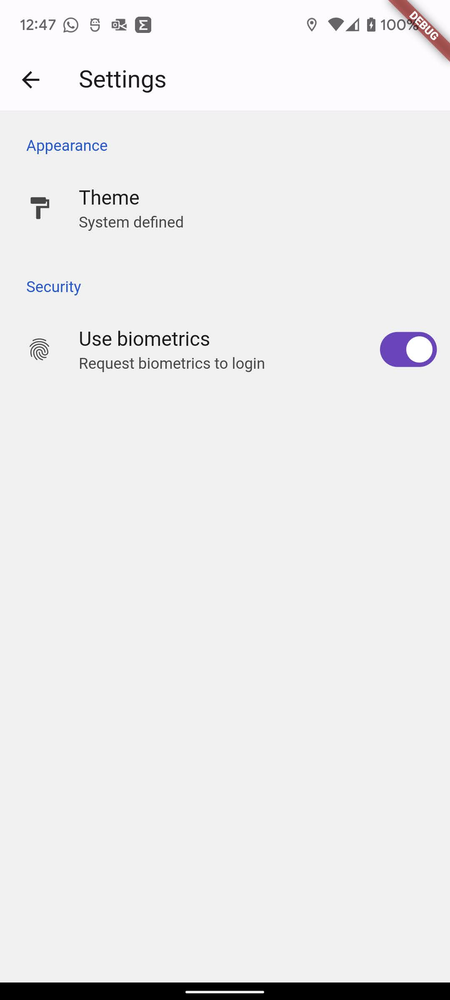
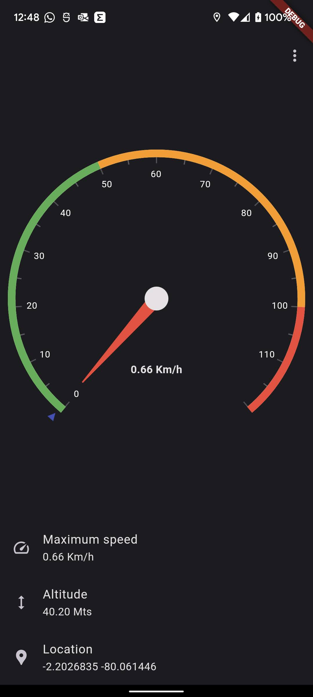

# Speedometer

Flutter app that measures how fast is moving the phone



It also have a dark mode and allows to ask for biometrics before go in the app



The dark mode



## Features

- Animated speed gauge with a top-speed marker
- Trip stats: top speed, average speed, distance and altitude
- Metric (km/h) or imperial (mph) units
- English and Spanish, light / dark / system theme
- Optional Face ID / fingerprint unlock

## Development

Flutter version is pinned in `.tool-versions` (same as Wallet):

```bash
asdf install
flutter pub get
flutter test
flutter run
```

## Downloads

Found it on [Google Play](https://play.google.com/store/apps/details?id=io.github.danny270793.speedometer)

## Follow me

- [Youtube](https://www.youtube.com/channel/UC5MAQWU2s2VESTXaUo-ysgg)
- [Github](https://www.github.com/danny270793/)
- [LinkedIn](https://www.linkedin.com/in/danny270793)

## LICENSE

Licensed under the [MIT](license.md) License

## Version

Speedometer version 1.1.0

Last update 04/10/2026

## Deploy

`./scripts/deploy.sh` builds a release APK and publishes it to Firebase App Distribution. Before the first run, copy `scripts/.env.deploy.example` to `scripts/.env.deploy` (gitignored), set `FIREBASE_GROUPS` to the tester group alias, and run `firebase login`. `--bump` raises the build number and `--dry-run` prints the commands without running them.
